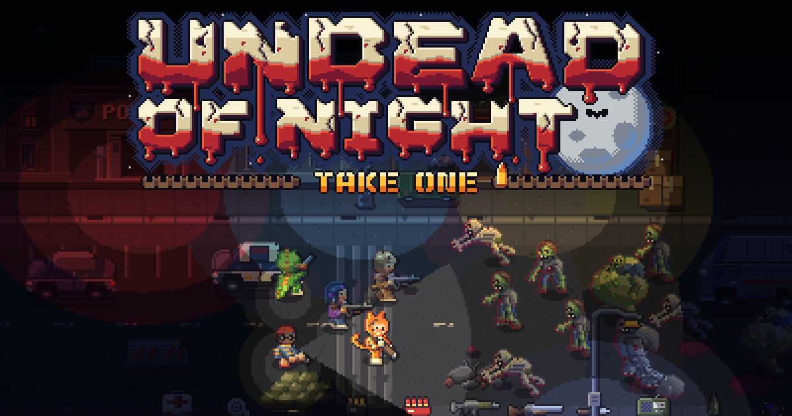

# Undead of Night: Take One

> **Candy, Fireworks, Zombies, and Music!!**

*It is Halloween night, the zombie apocalypse is upon us, and there is plenty of candy and music to go around. Light the fireworks!*

A Hall of the Gods, Inc. game. A top-down pixel art zombie survival horror where trick-or-treating turns into an escalating battle against the undead. Ammo and medical supplies are scarce, noise is lethal, and every gunshot echoes through the dark to pull the horde toward you. Raid front-porch candy bowls for sugar-rush combat buffs, blast original chiptune tracks, ignite spinner and fountain fireworks to blind and burn pursuers, barricade breached doors, and fight your way to the evacuation van.

**Play solo in your browser:** https://undeadofnight.forthexp.com/

## The Opening Cast

Five neighborhood kids caught out past curfew when the dead woke up:

- **Night**: Long cosmic starfield hair shimmering with violet nebula clouds and white stars, a matching violet hoodie with a white star insignia, denim jeans, and white sneakers. Trait: *Moves quieter*.
- **Bear**: The tallest teen of the crew, bundled inside a fuzzy brown grizzly bear suit with silvertip coat highlights, rounded ears, a snout hood over his forehead, and clawed mitten paws. Trait: *Reloads faster*.
- **Kat**: A twelve-year-old in a handmade orange tabby cat costume with pointed hood ears, a bright red collar, cream belly and paws, and an arched tail curling behind. Trait: *Runs faster*.
- **Rex**: A twelve-year-old stomping in a bright green dinosaur outfit with white felt teeth along the snout, fiery orange spine ridges, matching mittens, and a weighted tail. Trait: *Shoves harder*.
- **Rich**: Seven years old and the smallest survivor, wearing round glasses, dark hair under a red baseball cap with a blue visor, a striped yellow-and-blue tee, blue shorts, red sneakers, and an oversized canvas backpack. Trait: *Loots more*.

## The Run: Escalating to the End of the World

The danger and scope escalate with every single level across ten distinct towns. Surviving the early suburbs is only the opening warm-up. By the time you reach town ten, Tenver ("Final Stand"), the game reaches epic, chaotic proportions: it is by far the largest and most grueling challenge of the run.

You will not lose for lack of loot, weapons, or candy. The true threat is the sheer scale of the ongoing, unending horde swarming from every direction, bounded only by the population of the planet.

1. **One Lake City**: Silent Ruins (Night suburbs)
2. **Twoport**: Escalation (Industrial dusk)
3. **Three Suns**: Into the Breach (Scrapland)
4. **Fourkatello**: Abyssal Depths (Flooded marsh)
5. **Phivenix**: Contamination Zone (Blighted fungus)
6. **Sixinnati**: Blackout (Darkened district)
7. **Sevannah**: Quarantine Breach (Emergency military cordon)
8. **Eightlanta**: Frozen Wasteland (Snowbound tundra)
9. **Nine Vegas**: The Hive (Infested bio-nest)
10. **Tenver**: Final Stand (Burning ashland and the infinite horde)

Each town features its own unique environment, landmarks, ground acoustics, and custom soundtrack produced by Majora D. (Producer & Artist). The full mechanics are detailed in [docs/README.md](docs/README.md).

Multiplayer requires the dedicated co-op game server, which GitHub Pages cannot host. Run it locally or on a server to play together; see [docs/README.md](docs/README.md).

## Run it

```bash
pnpm install
pnpm dev            # the game on a Vite dev server
pnpm dev:server     # the co-op game server
pnpm test           # the test suite
pnpm run build      # type check and production build into dist/
```

## Repo, versions and deploys

This repo is a submodule of the Xophz-COMPASS monorepo (`apps/zombie-survival`). Commit and push here, then bump the pointer in the monorepo.

Every push to `main` runs the org's autobump through [Auto Version](.github/workflows/auto-version.yml): it calculates a minute-precision CalVer (`YY.M.D-MINUTES`), writes it to `package.json`, commits that as `chore: auto-bump version … [skip ci]` and tags `v<version>`. When Auto Version succeeds, [Deploy to GitHub Pages](.github/workflows/pages.yml) builds the bumped tip of `main` and publishes it. Do not edit the version by hand. A commit message holding `[skip ci]` is neither bumped nor deployed; run the Pages workflow by hand for those.

Music produced and performed by Majora D. (Producer & Artist). Licensed under the True Omni-Source License (TOSL) 1.0; see [LICENSE](LICENSE).
